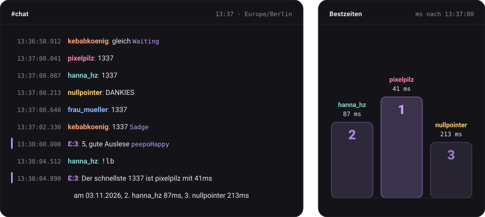
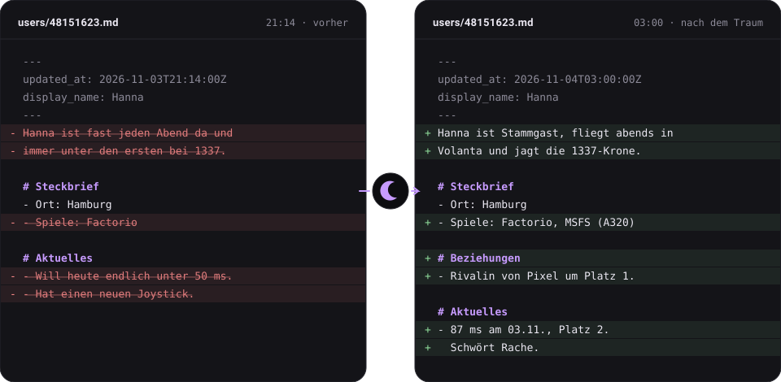
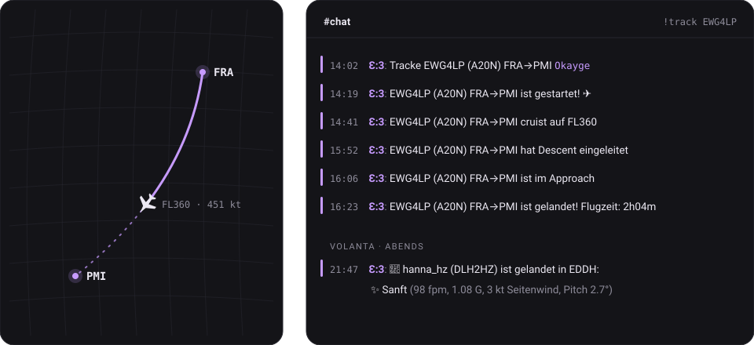
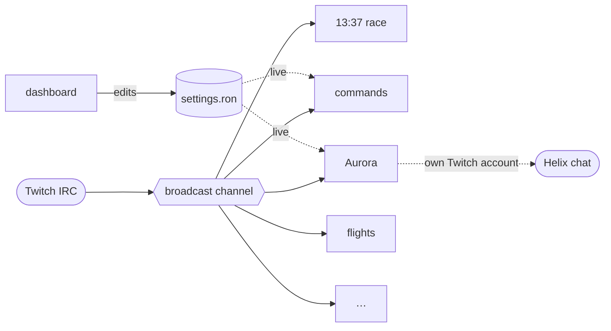
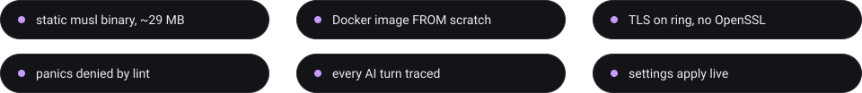

  

<em>A Twitch bot for one channel, with a mind of its own.</em>

  
  
  
  

Every day at **13:37** Berlin time, chat races to type `1337`. **Ɛ:3** keeps
score. Over the years it picked up a few other hobbies.

## The 13:37 race

> For one minute a day, Ɛ:3 watches chat with a stopwatch. A latency probe
> pings the IRC server every five minutes, so the bot wakes up early enough to
> catch the very first message, to the millisecond. Sub-second personal bests
> go on the board. The slowest go in the hall of shame.

## Aurora dreams

> Aurora, the AI who lives in chat, keeps a character sheet on every regular,
> a lore file for the channel and a soul file for herself. Every night the
> dreamer reads the day's transcript and rewrites them: what will still matter
> in two weeks moves up, the rest fades. Each sheet is capped at 4 KiB, so
> forgetting is part of the design.

## Flights

> `!track` follows a real aircraft over ADS-B from takeoff to touchdown and
> polls faster while it climbs, descends and lands. Regulars who fly in
> Volanta get their landings graded the moment the wheels settle: sink rate and
> G-force, one grade worse for every bounce.

## Under the hood

> One IRC connection, one broadcast channel, one task per feature. A slow
> feature lags on its own; a crashed one takes the whole bot down so it comes
> back clean, instead of limping on half-alive.

## License

Licensed under either of [Apache License, Version 2.0](LICENSE-APACHE) or
[MIT license](LICENSE-MIT) at your option.

Unless you explicitly state otherwise, any contribution intentionally submitted
for inclusion in this project by you, as defined in the Apache-2.0 license,
shall be dual licensed as above, without any additional terms or conditions.

